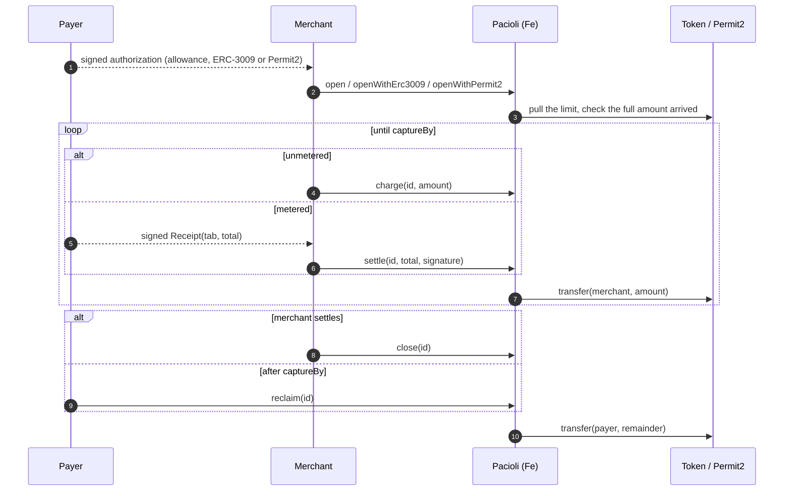
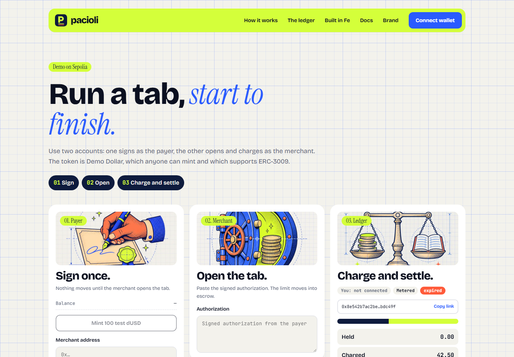
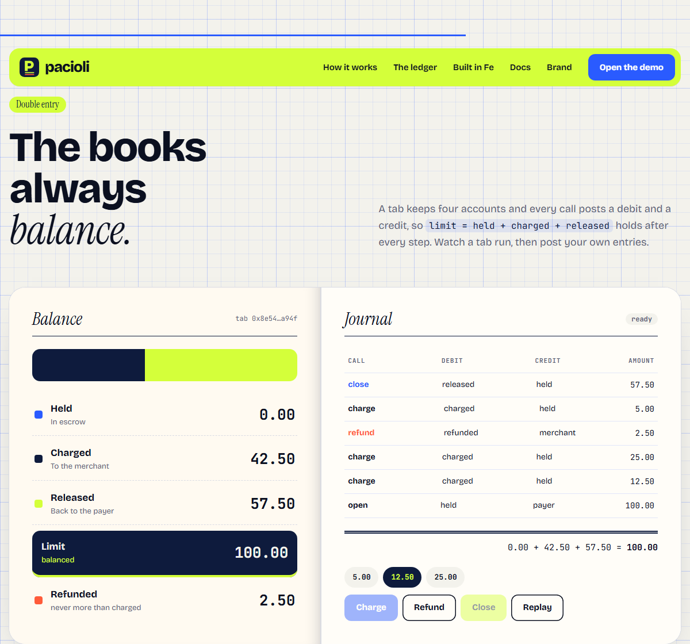
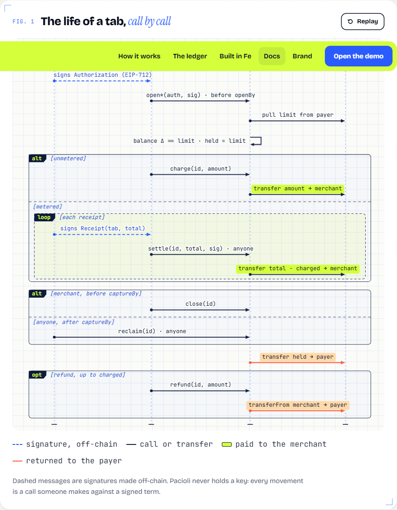

<p align="center">
  
</p>

<p align="center">
  <a href="https://github.com/enliven17/pacioli/actions/workflows/ci.yml"></a>
  
  
  
  
</p>

# Pacioli

**Pitch:** Pacioli is an auth-capture escrow in Fe that keeps every tab as a double-entry ledger. One signature opens a tab through an allowance, ERC-3009 or a Permit2 witness; the merchant charges what was used, or on a metered tab only what the payer signed receipts for; the rest goes back to the payer.

- [The problem](#the-problem)
- [Approach](#approach)
- [Fe highlight](#fe-highlight)
- [Architecture](#architecture)
- [Build and test](#build-and-test)
- [Demo](#demo)
- [Limitations](#limitations)
- [Declaration](#declaration)

## The problem

Card payments separate authorization from capture: a hotel, a ride or a metered API holds an amount first and charges the real cost later. On-chain payments usually move the full amount at once, so the payer either overpays and waits for a refund or signs again for every charge. The x402 `auth-capture` scheme describes the two-step flow for HTTP payments.

Two things make that flow awkward on chain. Funding needs an approval plus a signature, and the merchant can charge up to the limit on its own word. Pacioli answers both: one signature funds a tab through ERC-3009 or a Permit2 witness, and a metered tab can only be charged against receipts the payer signed.

| | Pay upfront | With Pacioli |
| --- | --- | --- |
| Moves at the start | 100.00 to the merchant | 100.00 into escrow |
| Real cost | 42.50 | 42.50 charged |
| The other 57.50 | Returned when the merchant sends it | Returned by the contract |
| Payer signatures | One per payment | One per tab, plus receipts if metered |

## Approach

The payer signs one EIP-712 `Authorization` (payer, merchant, token, limit, `openBy`, `captureBy`, `metered`, nonce). The tab id is its digest, so a signed authorization opens exactly one tab and no nonce storage is needed.



### Three funding sources, one trait

| Call | The payer signs | Approval | What binds the signature to the terms |
| --- | --- | --- | --- |
| `open` | The authorization | `approve(Pacioli, limit)` | Signature over the tab digest, EOA or ERC-1271 |
| `openWithErc3009` | `ReceiveWithAuthorization` | None | The ERC-3009 nonce is the tab id |
| `openWithPermit2` | `PermitWitnessTransferFrom` | `approve(Permit2)` once | The authorization is the Permit2 witness |

All three implement `trait Funding` and go through one generic `fund<F: Funding>`, which also checks that the escrow received the full limit. That rejects fee-on-transfer tokens and tokens without code.

### Metered receipts

On a metered tab, `charge` reverts. The payer signs `Receipt(bytes32 tab, uint256 total)` for a running total, and anyone may submit the latest one with `settle`: the contract pays the merchant `total - charged` and nothing more. Receipts only go up, so an old receipt is worth zero and a lost one is replaced by the next.

### The ledger

Each tab keeps five numbers, and each call posts to two of them.

| Call | Debit | Credit | Who |
| --- | --- | --- | --- |
| `open*` | held | payer | anyone, before `openBy` |
| `charge` | charged | held | merchant, unmetered, until `captureBy` |
| `settle` | charged | held | anyone, metered, until `captureBy` |
| `close` | released | held | merchant |
| `reclaim` | released | held | anyone, after `captureBy` |
| `refund` | refunded | merchant | merchant, up to `charged` |

Invariants: `limit = held + charged + released` and `refunded <= charged`. `accounts(id)` returns all five.

## Fe highlight

Every handler lists the state and capabilities it may touch, and the compiler enforces the list. `refund` cannot change the escrow, because `held` is not in its `uses`:

```fe
Refund { id, amount } uses (ctx, mut call, terms, charged, mut refunded, mut log) {
    ...
}
```

```
error[8-0116]: contract field `held` is not in this handler's `uses`
    │
    │             held.set(key: id, value: 0)
    │             ^^^^ `held` is not reachable here
```

Funding sources are a trait whose method declares its own effects, and the open path is generic over it. Adding a fourth source means adding one `impl`; the escrow checks come with it:

```fe
pub trait Funding {
    fn collect(self, auth: Authorization, id: u256, escrow: Address)
        uses (ctx: Ctx, call: mut Call)
}

fn fund<F: Funding>(_ source: F, auth: Authorization, id: u256)
    uses (ctx: Ctx, call: mut Call)
{
    let escrow = ctx.address()
    let before = balance_of(token: auth.token, account: escrow)
    source.collect(auth, id, escrow)
    if balance_of(token: auth.token, account: escrow) - before != auth.limit {
        revert_error(ShortFunding {})
    }
}
```

Other Fe features in use: `#[abi]` structs for the authorization and Permit2's nested tuples, a `DynString` witness type string, `std::evm::eip712`, `std::evm::signature` (ERC-1271), `std::evm::erc20`, and `std::evm::random::KeccakRng` driving the invariant tests.

## Architecture

```
src/
  lib.fe            Pacioli: handlers, ledger accounts, events, generic `fund`
  authorization.fe  Authorization and Receipt typed data
  funding.fe        trait Funding; Allowance, Erc3009, Permit2; Permit2 digest
  demo_token.fe     Demo Dollar: mintable test token with ERC-3009
  tests.fe          flows, reverts, invariants, typed-data vectors, mock Permit2
web/
  src/pacioli.ts    ABI and typed data for all four signatures
  src/landing/      landing page and the interactive ledger   /
  src/app/          demo with a wallet                          /app/
  src/docs/         documentation                               /docs/
  src/brand/        brand kit and README banner                 /brand/
  scripts/          deploy.ts, e2e.ts, smoke.ts, vectors.ts
```

## Build and test

```sh
fe --version   # fe 26.6.0
fe test        # 26 tests
fe build
```

The tests cover:

- **Every funding source**: allowance with an ERC-1271 wallet, ERC-3009 with no approval, and a Permit2 witness against a mock that verifies `permit2_digest`.
- **Every revert path**: expiry, double open, changed terms, stranger, over-charge, over-refund, `Metered`, `NotMetered`, `StaleReceipt`, unsigned receipt, and `ShortFunding` from a token that reports success without moving anything.
- **Invariants**: seeded random sequences of charges, refunds and receipts, with the ledger rule and every token balance checked after each step.
- **Typed-data vectors**: the authorization struct hash, digest and signature, the receipt digest and the Permit2 witness digest, computed by viem from `web/src/pacioli.ts` (`node web/scripts/vectors.ts`). `cast wallet sign --data` gives the same signature and `cast keccak` over `cast abi-encode` the same struct hash.

`pnpm run e2e` then runs all three sources on Anvil with the **real Permit2 bytecode** (`deploy.ts` copies it from Sepolia to the canonical address): allowance with charges, close and refund; ERC-3009 with signed receipts; Permit2 with a charge, a time jump and `reclaim`. It checks the books after each.

## Demo

Live on Sepolia: [Pacioli](https://sepolia.etherscan.io/address/0xf850739833d8bdb5fe5cf5876cdb14d861697318) and [Demo Dollar](https://sepolia.etherscan.io/address/0xc15038738507e7634a1d36a178e7b2211869eed1), with the canonical Permit2. `pnpm run smoke` opens a metered tab there with one ERC-3009 signature, settles a receipt and closes it, then opens a tab through Permit2, charges it and closes it.

| Landing | Demo, a settled metered tab on Sepolia |
| --- | --- |
|  |  |

| The ledger, posting a scripted tab | Brand kit |
| --- | --- |
|  |  |

The docs page draws the protocol as animated diagrams: the life of a tab, the three funding paths, the ledger postings and metered receipts.



```sh
anvil                      # local chain, in another terminal
fe build
cd web && pnpm install
pnpm run deploy            # Pacioli, Demo Dollar, and Permit2 on Anvil
pnpm run e2e               # every funding source, receipts, reclaim
pnpm dev                   # landing, demo, docs, brand kit
```

`pnpm run deploy` and `pnpm run smoke` read `RPC_URL` and `PRIVATE_KEY` to use another network.

## Limitations

- Not audited. Do not use with real funds.
- On an unmetered tab the merchant can charge up to the limit on its own word; use a metered tab when that matters.
- A signed authorization cannot be cancelled before `openBy`. Keep `openBy` short.
- `close` and `reclaim` push the remainder to the payer. If the token blocks transfers to the payer (a blacklist, a pause), the remainder is stuck.
- Rebasing tokens are not supported; fee-on-transfer tokens are rejected at open (`ShortFunding`).
- There is no operator or fee role, and refunds have no deadline.
- `open*` is permissionless, so the merchant's own open can revert with `AlreadyOpen` if someone submitted the authorization first. The tab has the signed terms either way.
- `fe test` cannot move block time, so expiry is tested with deadlines in the past; the time jump to `reclaim` is covered by the Anvil e2e.
- The Permit2 path is tested in Fe against a mock that implements the witness digest, and end to end against the real Permit2 bytecode on Anvil and on Sepolia.

## Declaration

- **Pre-existing work:** None. The repository starts from the Fe Builders Challenge starter. It began during the contest as `Tab`, a single-source auth-capture escrow, and was extended and renamed to Pacioli within the contest window; the git history shows both.
- **Third-party code:** The starter's `LICENSE`, CI workflow and project layout (Apache-2.0). The flow follows the x402 `auth-capture` scheme and the design of `base/commerce-payments`; the Permit2 witness and ERC-3009 interfaces follow Uniswap Permit2 and EIP-3009. No code was copied from any of them.
- **AI assistance:** Claude Code was used to write and review the contracts, tests, web app and documentation. The illustrations were generated with OpenAI Codex image generation from written prompts; the logo was drawn by hand as SVG.

## Team

Cankat Polat ([@enliven17](https://github.com/enliven17))

## License

Apache-2.0
